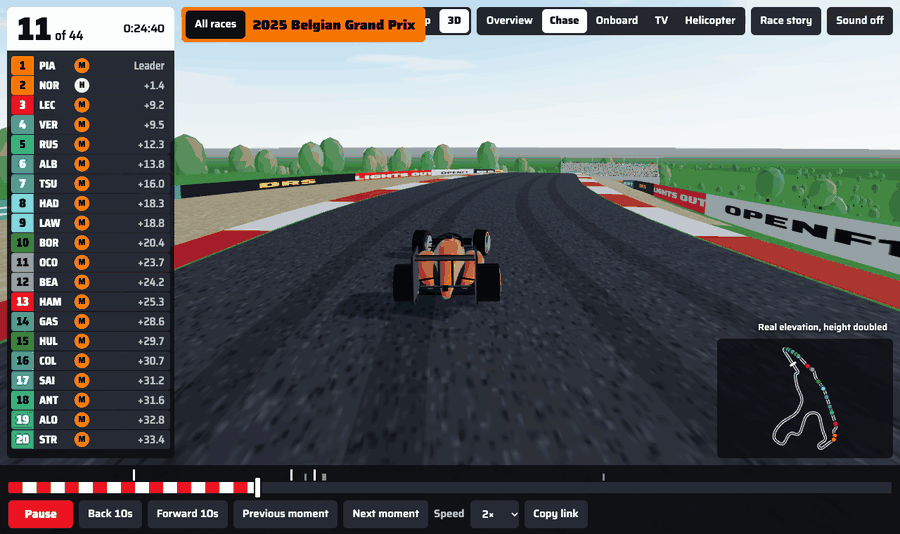
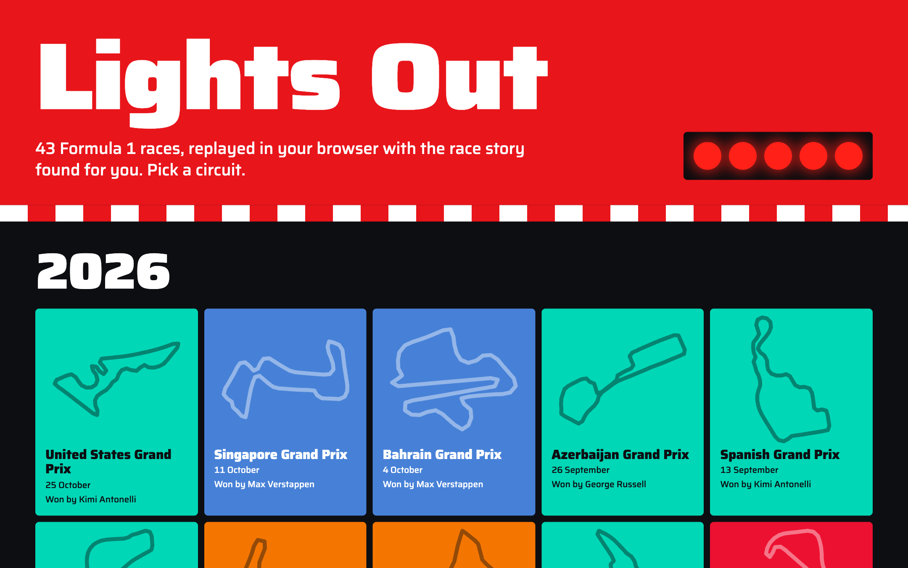
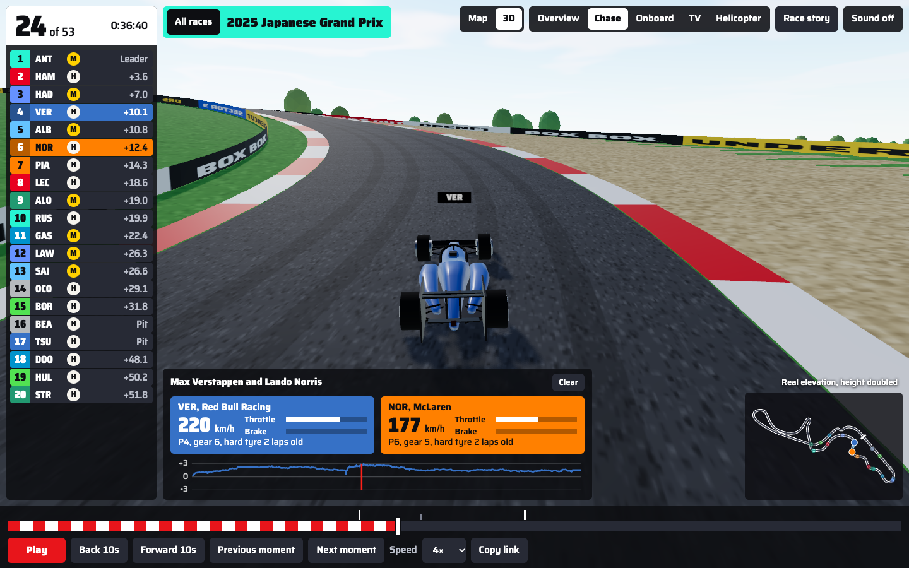
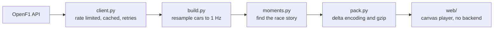

<div align="center">

# Lights Out

**43 Formula 1 races, replayed in your browser in 2D and 3D, with real engine sound, team radio and the race story found for you.**

[**Open the live replay**](https://dhairya-007.github.io/lights-out/)

[](https://github.com/Dhairya-007/lights-out/actions/workflows/pages.yml)


[](LICENSE)



</div>

Most F1 replay projects are desktop apps you clone and run. Lights Out compiles a race into small static files, so a replay is a link you can send to someone. The link keeps the exact moment and drivers you were looking at.

It also works out what happened. A Python pipeline reads the raw timing data and finds the passes, undercuts, lead changes and retirements, and you can click any of them to jump there.

## What you can do

**Pick a race from its circuit.** Every race of 2025 and the 2026 season so far is here, each shown in the winning team's colours. Every outline is traced from the real cars in that race.



**Watch in 3D.** The race fills the window, with a broadcast timing tower, a minimap and captions that appear as moments happen. The land and the circuit follow each track's real elevation, so Spa climbs and Silverstone stays flat. Orbit the whole track, or follow a driver from the chase, onboard, TV and helicopter cameras. Cars move through corners on smooth curves, with wheels that spin and steer, tyre bands in the real compound colour, and brake dive. Height is doubled so the hills read clearly on screen.



**Hear the race.** The sound is built from real F1 recordings, the way racing games layer engine sound. Engine clips loop and change pitch with the followed car's speed, gear and throttle, and a real British Grand Prix crowd reacts to the start and the finish. At 1× and 2× you ride with the engine. At higher speeds it switches to occasional real cars passing the trackside. The recordings are cleaned of wind noise, and there's a volume slider. Recorded engines are V8 and V10 cars from 2005 to 2010, so they aren't the sound of the current V6 power units.

**Listen to team radio.** Real driver radio plays at the moment it was sent, or pick any clip from the Radio filter in the race story. Clips stream from Formula 1's own servers and aren't stored here.

**Beat the start lights.** Press play at the start of a race and five lights come on, then go out after a random hold, as they do on a real grid. Press when they go out to see your reaction time. Go early and it's a jump start.

**Read the race story.** Filter detected moments by key events, strategy or passes, then click one to jump there with both drivers selected.

**Compare two drivers.** See live speed, throttle, brake, gear and tyres, plus the gap between them across the whole race.

**Share a moment.** Links look like `?race=2025-monaco-grand-prix&t=5950&drivers=NOR,VER`.

| Key | Action |
| --- | --- |
| `Space` | Play or pause, or react to the start lights |
| `←` `→` | Skip 10 seconds |
| `n` `p` | Next or previous moment |
| `l` | Show or hide car labels |
| `v` | Switch between map and 3D |
| `c` | Change the 3D camera |
| `m` | Turn sound on or off |
| `s` | Open or close the race story |

## How it works



### Finding the real story

The raw feed reports every swap in the running order, and most of those aren't racing. The first version found 72 "passes" at the 2025 Monaco Grand Prix, a circuit where almost nobody passes. It now finds 12, because every detection has to survive these checks:

| Moment | Rule |
| --- | --- |
| Pass | Cars within 60 m, order holds for 15 s, no pit stop or retirement nearby, green track, before the flag |
| Undercut | Car behind, within 6 s, stops up to 3 laps earlier and comes out ahead |
| Overcut | Car ahead stops first and loses the place to the car that stayed out |

Stops under a safety car and stops around wet tyres don't count as undercuts, because those gains come from the race situation or the weather rather than from pit timing.

One detail worth knowing if you use this data: OpenF1 stamps a pit stop at **pit exit**, so Lights Out subtracts the lane time to find pit entry. With that correction, median speed during the stop window comes out at 60 km/h at Monaco and about 80 km/h elsewhere, matching the pit speed limits.

These rules are heuristics. They can include an incidental swap or miss a real move, so treat the counts as estimates rather than official statistics.

### Building the real track

A single lap of position data isn't a usable map, because the feed drops out and that cuts corners. Lights Out takes up to 15 clean laps from the top three finishers, resamples each one by distance, and keeps the median of every point. That gives the true circuit shape and height, and Spa comes out at 102 m of climb and Monaco at 41 m, both close to the real figures.

The 3D world is then fitted around that line. It measures the free space on both sides of every point on the lap, so barriers hug the road at Monaco and sit back at Silverstone, gravel only appears on the outside of corners, and buildings are placed only where they clear the track. The pit building goes on the side cars really use, worked out from where they go during stops.

### Built to load fast

| | First version | Now |
| --- | --- | --- |
| Race size on disk | 3 MB of JSON | about 0.6 MB |
| Car data in the browser | Millions of characters to parse | Typed arrays decoded from binary |
| CPU while paused | Animation loop always running | No loop, nothing to do |
| Fonts | System fallback | One self-hosted variable font, 99 KB |
| 3D library | Not used | Three.js tree-shaken to about 170 KB gzipped, downloaded only when you open 3D |
| 3D drawing | Not used | Draws only when something changes, shares car geometry, instances trees and crowds, and lowers quality on slow devices |
| Audio | Not used | 350 KB of clips, downloaded only when you turn sound on |

Car positions and telemetry are stored as the change from the previous sample, which suits gzip, and the browser decompresses them with the built-in `DecompressionStream`.

### Designed from the sport

The look comes from a race weekend rather than a template. Team colours fill the screen: each race on the home screen wears the winning team's colour, the header changes to the current leader's colour when the lead changes, and the gap chart takes the colour of whichever driver is ahead. The timeline is a kerb, and the running order is a broadcast timing tower. Text picks black or white automatically to stay readable on any team colour, controls work from the keyboard, touch targets are 44 px on phones, and animations respect reduced-motion settings.

## Run it yourself

Everything here is free. The data needs no key or account, the audio is Creative Commons, and the site runs on GitHub Pages. You need [uv](https://docs.astral.sh/uv/).

```bash
git clone https://github.com/Dhairya-007/lights-out.git
cd lights-out
python3 -m http.server --directory web 8000
```

Open <http://localhost:8000>. The included races are ready to use. To add more:

```bash
uv sync --extra dev
uv run lightsout races 2024          # list a season
uv run lightsout build 2024 Monaco   # build one race, a few minutes
uv run lightsout season 2024         # build every finished race, skipping ones already built
uv run pytest                        # run the tests
npm install && npm run build:3d      # rebuild the 3D bundle after editing web/view3d.js
```

## Data

All data comes from the free [OpenF1 API](https://openf1.org), which covers 2023 onwards. Free access can pause while a live session is running, so build races once a session has finished.

OpenF1's position data for the 2026 Hungarian Grand Prix is faulty, so that race's track is about 15% too short and uses the elevation from 2025. Four 2026 races (Australian, Chinese, Japanese and Miami) have no team radio in OpenF1.

Lights Out doesn't use FastF1. Formula 1's live timing archive, which FastF1 reads from, returned `401 Unauthorized` when this project was built.

## License

Code is MIT. Three.js is MIT and the Saira font is under the SIL Open Font License. Audio clips keep their Creative Commons licences and are credited in [web/audio/CREDITS.md](web/audio/CREDITS.md). Team radio belongs to its owners and is linked, not redistributed. This is an unofficial fan project, not associated with Formula 1 or any team. F1 and related marks belong to their owners.
